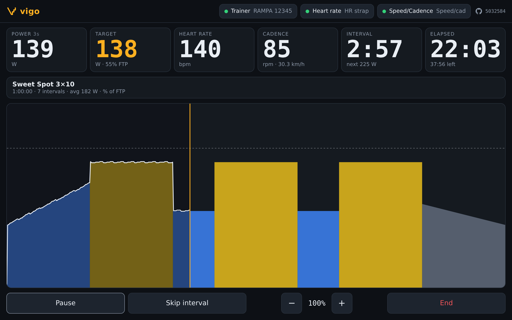
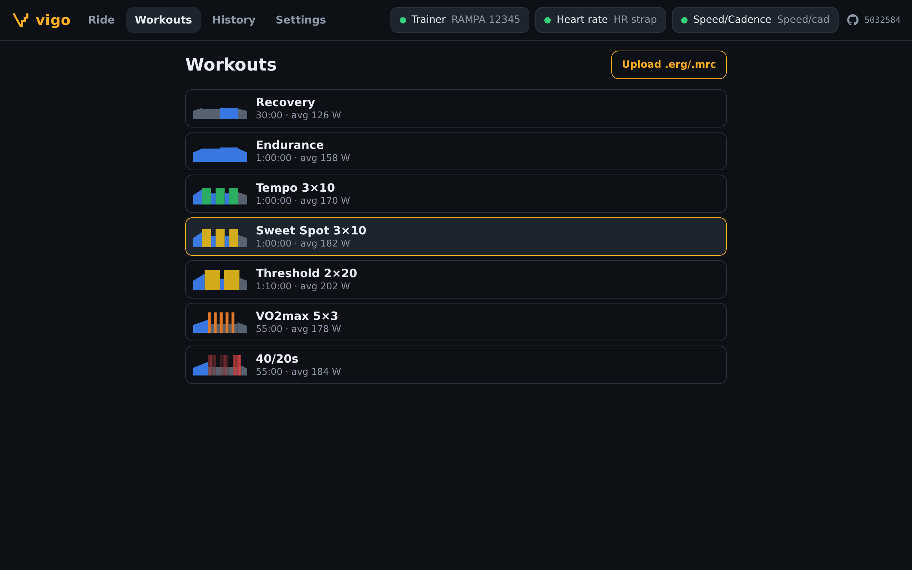

# vigo

**vigo** is a web app for indoor cycling **ERG workouts**. It runs structured interval sessions on a bike trainer.

In ERG mode the trainer sets its resistance to hold the target power of each interval, whatever gear you're in
or however fast you pedal. You ride the workout, and vigo tells the trainer what power to hold, second by second.

Open it at **https://n03l.github.io/vigo/**. It works in Chrome or Edge on Android, Windows, macOS, Linux and
ChromeOS. It doesn't work on iPhone or iPad, because Safari has no Web Bluetooth. To install vigo as an app,
use **Install app** or **Add to home screen** in Chrome's menu.

## What you need

- **A smart trainer: an Elite Rampa, or any trainer with Bluetooth FTMS.** vigo controls it in ERG mode
  over Bluetooth and reads power and cadence from it. FTMS ("Fitness Machine Service") is the standard
  Bluetooth trainer control, which most current smart trainers have.
- **Optional: a Bluetooth heart rate strap.**
- **Optional: a Bluetooth speed/cadence sensor.**

## Using vigo

1. **Register your devices** in **Settings → Devices**. Tap **Register** for the trainer, the heart rate
   strap and the speed/cadence sensor, and pick each one in Chrome's Bluetooth list. You only do this once.
   **Unregister** makes vigo forget a device.
2. **Set your FTP** in **Settings**, and pick your tyre size. The tyre size is used for speed and distance
   from the speed sensor.
3. **Pick a workout** in **Workouts**.
   - vigo comes with seven: Recovery, Endurance, Tempo 3×10, Sweet Spot 3×10, Threshold 2×20, VO2max 5×3 and
     40/20s.
   - **Upload .erg/.mrc** adds your own. They're the plain-text workout files that TrainerDay and similar sites
     export. [TrainerRoad's guide](https://support.trainerroad.com/hc/trainerroad-support/articles/201944204-creating-a-workout-from-an-erg-or-mrc-file)
     explains the format.
   - The easiest way to make one is often to ask ChatGPT or Gemini, for example "write a 45 minute sweet spot
     workout as an MRC file", and save the answer as a `.mrc` file. vigo checks the file when you upload it and
     says which line is wrong.
   - In MRC files, intervals are a percentage of FTP.
   - In ERG files, intervals are in watts. If the file says which FTP it was written for, the watts are scaled
     to yours; otherwise they're used as they are.
4. **Ride.** Press **Start**.
   - **−** and **+** make the whole workout 5% easier or harder.
   - **Skip interval** jumps to the next interval.
   - **Pause** releases the resistance.
   - Before the power changes, vigo beeps for the last 5 seconds and the Interval tile counts down, so you
     can shift in time. It chimes at the end of the workout and sounds an alarm if the trainer drops out.
     **Settings → Sounds** turns the sounds off; the countdown on screen stays.
   - If the trainer can't hold the target at your cadence, the Target tile says **Pedal faster**. Only
     the Rampa reports this, FTMS has no way to say so.
5. **Export.** Finished rides are listed in **History**, with a **.FIT** download you can upload to Strava,
   intervals.icu or Garmin Connect. A ride that was cut short, by closing the tab for example, is saved
   there too, marked "stopped early".

If a device drops out during a ride, vigo pauses the workout, reconnects, and carries on by itself.

## Connecting automatically: Chrome's experimental features

Out of the box, Chrome makes every website ask before using a Bluetooth device. So each time you open vigo,
it shows a **Connect …** button for each saved device, and each one needs a tap.

Two Chrome settings remove that step. With them on, vigo connects your saved devices as soon as it opens.
If a device is still off, vigo keeps looking for it until you switch it on.

**On Android or a computer, in Chrome:**

1. Type `chrome://flags` in the address bar and open it. In Edge, it's `edge://flags`.
2. In the search box at the top, type **Experimental Web Platform features**. Set it to **Enabled**.
   - The full address of this setting is `chrome://flags/#enable-experimental-web-platform-features`.
3. Search for **Web Bluetooth**. Find **Use the new permissions backend for Web Bluetooth** and set it to
   **Enabled** too.
   - The full address is `chrome://flags/#enable-web-bluetooth-new-permissions-backend`. It makes Chrome
     remember your devices after you restart the browser.
4. Tap **Relaunch** at the bottom of the page. Chrome restarts.
5. Open vigo. In **Settings → Devices**, register your devices once more.

The Devices section now starts with "Automatic: saved devices connect when vigo opens…". If it still says
"One tap per device", the settings aren't on yet.

If you only enable the first setting, vigo still works: Chrome forgets the devices whenever vigo is
reloaded or Chrome restarts, so it falls back to one tap per device, and **Settings → Devices** says which
setting is missing.

These are experimental Chrome features. They apply to every website, not only vigo, and Google can change or
remove them in a future Chrome version. To turn them off, set both back to **Default** and relaunch.

## Your data

- **Everything stays in your browser.** Workouts, ride history and settings are kept only there. vigo has no
  server and doesn't send anything anywhere. Strava or intervals.icu only get a ride if you upload its .FIT
  file yourself.
- **Clearing data deletes it.** Clearing the browser's site data for vigo deletes your uploaded workouts and
  ride history. Download the .FIT files of any rides you want to keep first.

## License

vigo is free software, licensed under the [GNU Affero General Public License v3.0 or later](LICENSE).

You can use, change and share it. If you change vigo and let other people use your version, for example on
your own website, you must also give them the source code of your version. vigo's top bar links to its source
code on GitHub, so keep a link like that pointing to your changed code.
